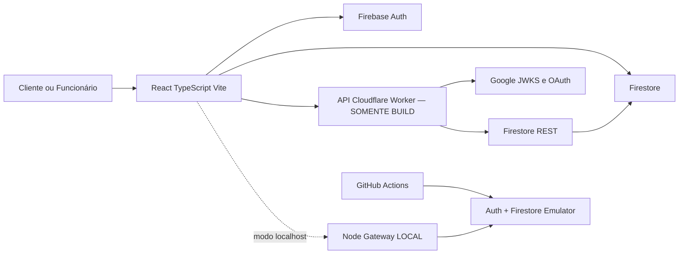
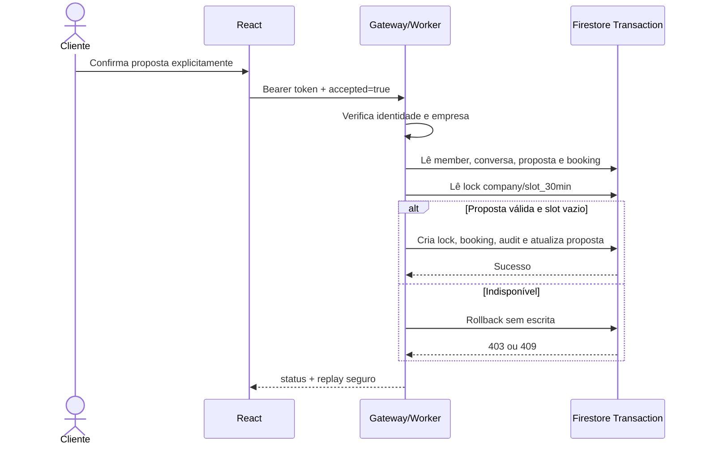
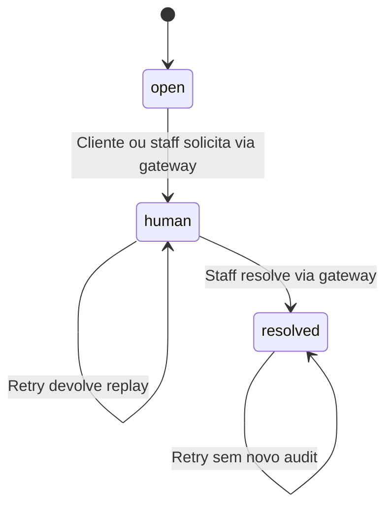

# RFBAgent — diagramas técnicos implementados (núcleo de teste, não produção)

## C4 — contêineres

## Agendamento serializado

## Handoff auditado

## Regras de privilégio
- Cliente não altera role, status, auditoria ou booking pelo Firebase SDK.
- Client lê mensagens/booking filtrados por customerUid e empresa.
- Staff lê fila e audit, resolve no gateway, não diretamente pelo Firestore.
- A API Worker usa conta de serviço IAM e precisa validar manualmente papel e tenant; `RFB_WORKER_ENABLED=false` no build.

Outros diagramas da especificação original: docs/source/DIAGRAMAS.md. Nenhum diagrama representa integração de produção que não ocorreu.
