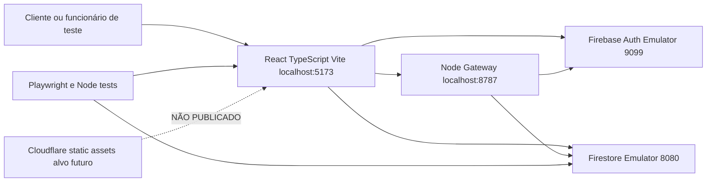
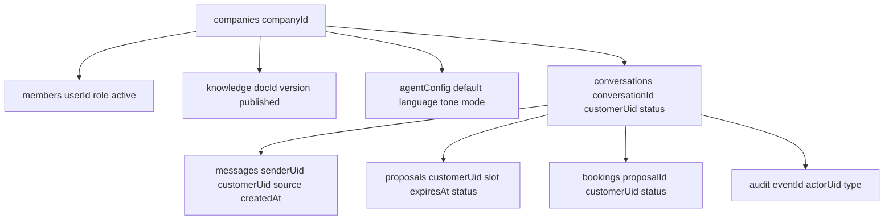
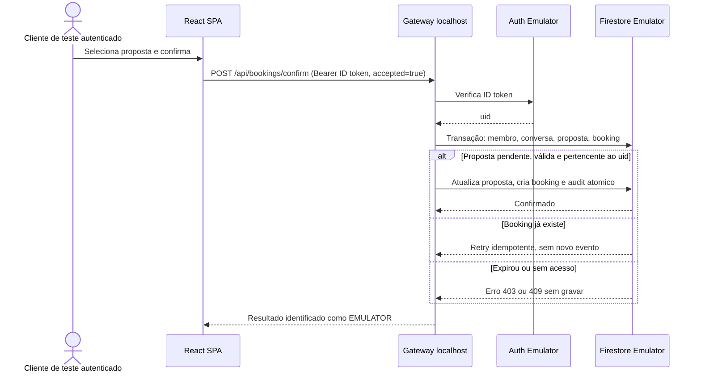
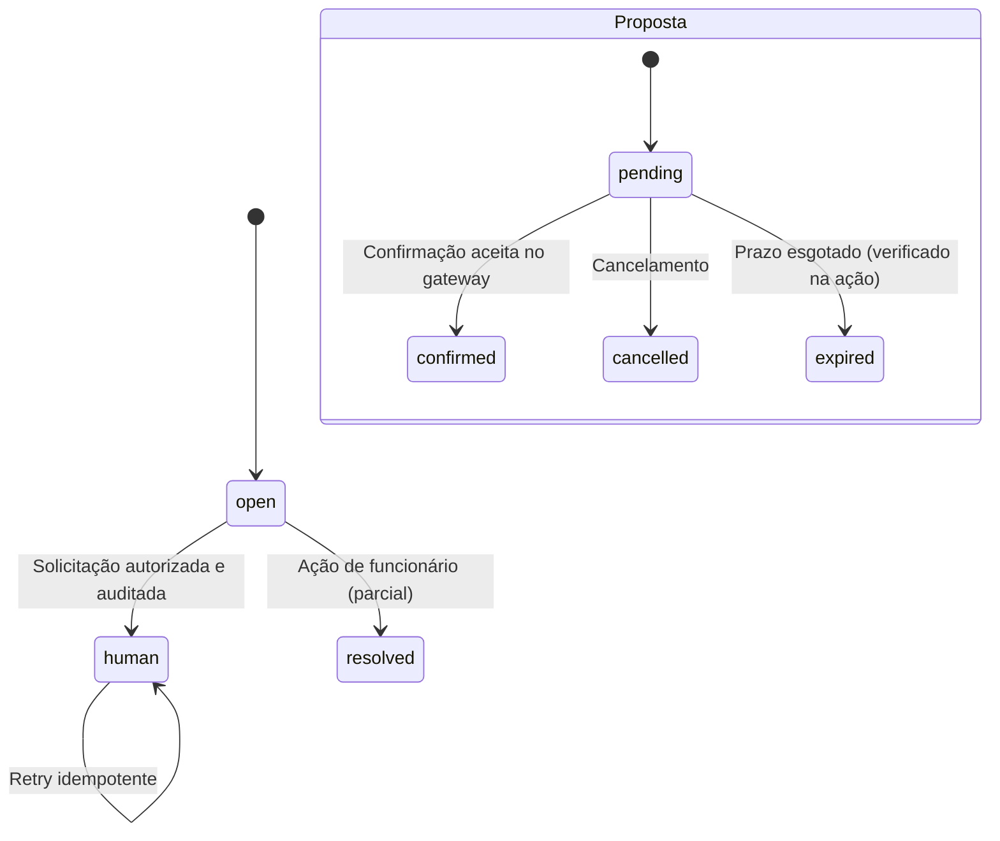

# RFBAgent — diagramas do código implementado

Esses diagramas descrevem **somente o código presente na branch do PR #1**. Não representam produção, um Worker Cloudflare implantado, nem IA generativa funcional.

## C4 — contêineres do ambiente local

## Domínio de dados por empresa

## Sequência — confirmação idempotente no gateway local

## Máquina de estado: solicitação humana e agendamento

## Fronteiras de confiança

- Frontend não pode atribuir roles, escrever audit ou criar booking diretamente.
- Firestore Rules verificam membership, customerUid, papéis e campos aceitos; listagem de filhos do cliente exige filtro de ownership.
- Gateway local verifica ID token e realiza ações explícitas e auditáveis em transações; não recebe chaves de produção.
- Módulo lexical nunca aciona booking a partir de texto livre. Falha na recuperação oferece atendimento humano.
- Cloudflare e Firebase reais são fronteiras futuras sem homologação ou produção autorizada.

Fonte do escopo: docs/source/ESPECIFICACAO-RFB.txt e docs/source/DIAGRAMAS.md. Modelos originais preservados.
